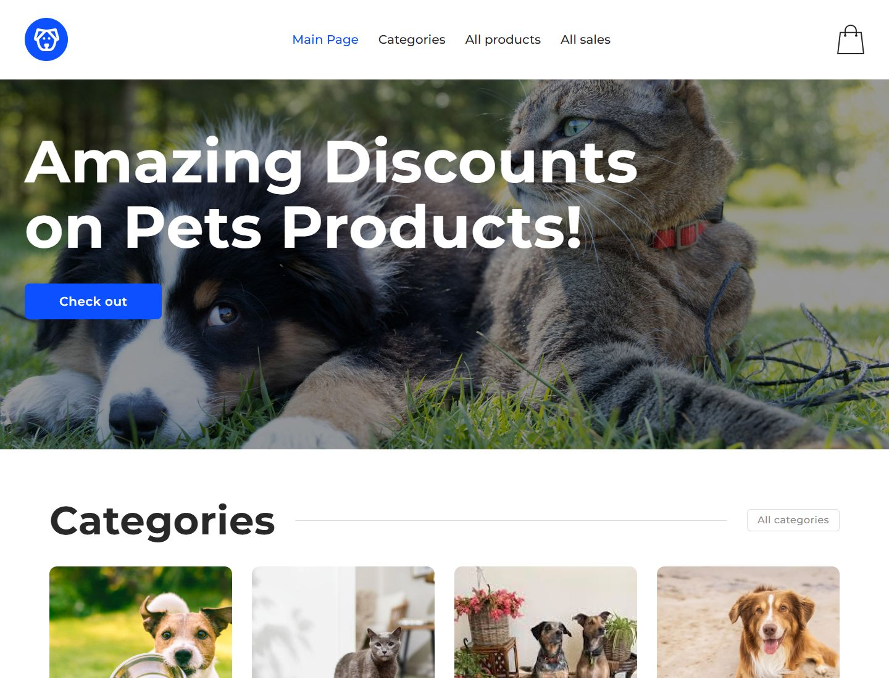
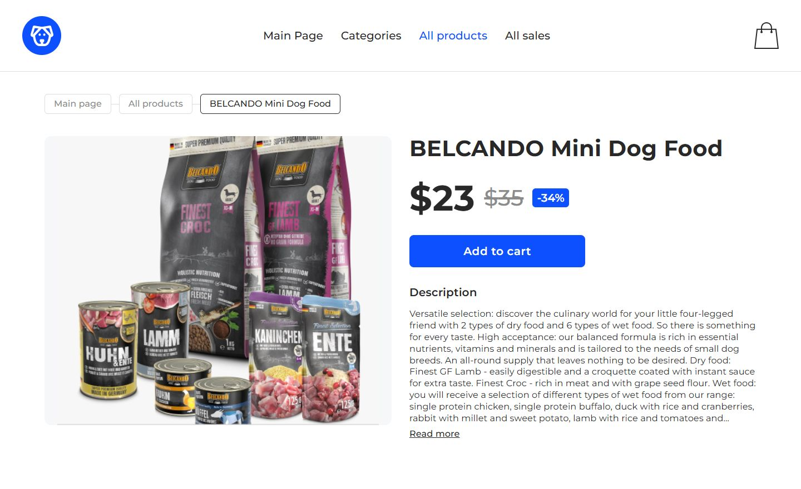
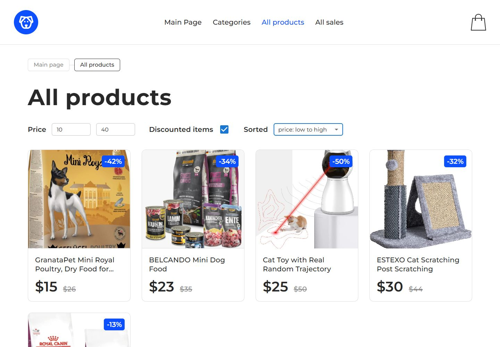
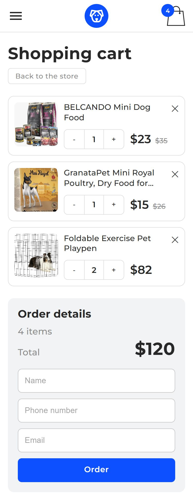

# 🐾 Pet Shop


A full-stack online shop for pet products: catalog with categories, product pages,
filters, discounts, a shopping cart and an order form.

> **Learning project.** I built this project during my *Weiterbildung* (further
> training) at [ITCareerHub.de](https://itcareerhub.de). The **UI design was provided
> by the course**, as well as a starter version of the backend API. My work: the
> complete React frontend, connecting it to the API, extending the backend
> (protected create/update/delete endpoints, validation, CORS and environment
> config) and deploying both parts.

## 🚀 Live demo

| Part | URL | Hosting |
|---|---|---|
| Frontend | https://pet-shop-roan-five.vercel.app | Vercel |
| Backend API | https://pet-shop-api-3od3.onrender.com | Render (free plan) |

⏳ The backend runs on Render's free plan and **sleeps after 15 minutes without
traffic**. The first request after that takes about 20–60 seconds; the site shows a
"Server is waking up…" message meanwhile. After that it is fast.

## 📸 Screenshots

| Home page | Product page |
|---|---|
|  |  |

| Filters: price range, discounted items, sorting | Cart on mobile |
|---|---|
|  |  |

## ✨ Features

**Shop**
- Home page with hero banner, categories, "first order" discount form and sale products
- Categories, products per category, all products, all sales
- Product page with price, discount badge and expandable description
- 404 page for unknown routes

**Filters and sorting** (shared by all product lists)
- Price range with input validation: only non-negative numbers, decimal comma
  becomes a point, `.25` → `0.25`, `007` → `7`; a hint when "from" is higher than "to"
- "Discounted items only" checkbox and sorting by price or name
  (plus "biggest discount" on the sales page)
- Empty state with a "Reset filters" button
- Filter values are remembered in `localStorage`

**Cart and order**
- Add / remove products, change quantity, total price with discounts
- Cart is stored in Redux and persisted in `localStorage`
- Order form and discount form with client-side validation, "Sending…" state and
  error messages

**UX details**
- Responsive layout from 320px up, with a shared mobile size scale
  (`src/theme/mobile.js`); compact cart cards on phones
- Loading states with a "server is waking up" hint for slow first requests
- Placeholder image when a product image is missing or fails to load
- Accessible labels for form fields, breadcrumbs and icon buttons

**Backend**
- REST API with Express and Sequelize (SQLite)
- Full CRUD for products: create, update and delete are protected with an API key
- Shared validation for create and update (types, discount lower than price,
  existing category)
- CORS restricted to an allow-list of frontend URLs

## 🛠 Tech stack

| Area | Technologies |
|---|---|
| Frontend | React 19, Vite 8, React Router 7, Redux Toolkit (`createSlice`, `createAsyncThunk`), React Redux, MUI 9 + Emotion (`sx` styling), Axios |
| Backend | Node.js, Express 4, Sequelize 6, SQLite, cors, dotenv |
| Tooling | ESLint 9, nodemon |
| Deployment | Vercel (frontend), Render (backend) |

**State management:** Redux Toolkit holds products, categories and the cart.
Async thunks load data from the API and skip the request when data is already
loaded. The cart is saved to `localStorage`. Component state (forms, filters) uses
React hooks, including custom hooks `useLocalStorage` and `useProductFilters`.

## 📂 Project structure

```text
pet-shop/
├── src/                      # React frontend
│   ├── components/           # UI parts: header, footer, product card, filters, ...
│   ├── pages/                # Route pages: home, categories, products, cart, 404, ...
│   ├── redux/                # Store and slices (products, categories, cart)
│   ├── hooks/                # useLocalStorage, useProductFilters
│   ├── theme/                # Mobile size scale
│   └── constants/api.js      # API base URL (VITE_API_URL)
├── server/                   # Express backend (see server/README.md)
│   ├── routes/               # categories, products, order, sale
│   ├── middleware/auth.js    # API key check for admin endpoints
│   ├── validation/           # Product validation for POST and PUT
│   ├── database/             # Sequelize setup and models
│   └── public/               # Product and category images
├── docs/screenshots/         # Images for this README
└── vercel.json               # SPA routing on Vercel
```

## 🔌 API

Base URL: `https://pet-shop-api-3od3.onrender.com` (locally `http://localhost:3333`)

| Method | Endpoint | Description | Auth |
|---|---|---|---|
| GET | `/categories/all` | All categories | – |
| GET | `/categories/:id` | Category with its products | – |
| GET | `/products/all` | All products | – |
| GET | `/products/:id` | One product | – |
| POST | `/products/add` | Create a product | `x-api-key` |
| PUT | `/products/:id` | Update fields of a product (partial update) | `x-api-key` |
| DELETE | `/products/:id` | Delete a product | `x-api-key` |
| POST | `/order/send` | Send an order (demo, not stored) | – |
| POST | `/sale/send` | Request the first-order discount (demo, not stored) | – |

Example:

```bash
curl -X PUT http://localhost:3333/products/1 \
  -H "Content-Type: application/json" \
  -H "x-api-key: <your ADMIN_API_KEY>" \
  -d '{"price": 40, "discont_price": 30}'
```

Invalid data returns `400` with a list of errors, a missing or wrong key returns
`401` / `403`. More details: [server/README.md](server/README.md).

## ⚙️ Run locally

Requirements: **Node.js 20.19+** (or 22.12+) and npm.

```bash
git clone https://github.com/LarysaSperling/pet-shop.git
cd pet-shop
```

**1. Backend** (terminal 1)

```bash
cd server
npm install
cp .env.example .env      # then set your own ADMIN_API_KEY
npm run dev               # http://localhost:3333
```

**2. Frontend** (terminal 2, project root)

```bash
npm install
cp .env.example .env      # VITE_API_URL=http://localhost:3333
npm run dev               # http://localhost:5173
```

Without a `.env` file the frontend uses the deployed backend on Render.

### Environment variables

| File | Variable | Purpose |
|---|---|---|
| `.env` | `VITE_API_URL` | Backend URL for the frontend (default: Render URL) |
| `server/.env` | `PORT` | Server port (default `3333`; Render sets it automatically) |
| `server/.env` | `ADMIN_API_KEY` | Secret key for POST / PUT / DELETE product endpoints |
| `server/.env` | `CORS_ORIGINS` | Allowed frontend URLs, comma-separated (default: Vercel URL and `http://localhost:5173`) |

### Scripts

| Where | Command | What it does |
|---|---|---|
| root | `npm run dev` | Start the frontend dev server |
| root | `npm run build` | Production build into `dist/` |
| root | `npm run lint` | Run ESLint (frontend and backend) |
| `server/` | `npm run dev` | Start the API with auto-restart (nodemon) |
| `server/` | `npm start` | Start the API (used on Render) |

## ⚠️ Known limitations

This is a learning project, and some parts are intentionally simple:

- **Cold start:** the free Render instance sleeps after 15 minutes; the first
  request takes about 20–60 seconds.
- **Data is reset on restart:** the database is an SQLite file on Render's
  temporary disk. Products added, changed or deleted through the API are lost
  when the server restarts or is redeployed. A hosted database (e.g. PostgreSQL)
  would fix this.
- **Orders are not saved:** `/order/send` and `/sale/send` only confirm the
  request; there is no order history and no emails are sent.
- **No user accounts or admin UI:** protected endpoints use one API key and are
  meant to be called with tools like Postman or curl.
- **No automated tests yet.**

## 🔮 Possible next steps

- Tests: Vitest + React Testing Library for the frontend, Jest + Supertest for the API
- PostgreSQL (e.g. Neon) instead of SQLite, so data survives restarts
- Store orders in the database
- Simple admin page for managing products
- TypeScript

## 💡 What I practiced

- Building a multi-page React app with React Router and Redux Toolkit
- Working with a REST API: loading, error and slow-server states
- Turning a given design into a responsive layout with MUI, from 320px to desktop
- Reusable components and custom hooks instead of copy-pasted logic
- Express backend: routes, middleware, validation, CORS and environment variables
- Deployment on Vercel and Render, and debugging production issues
  (SPA routing, CORS, cold starts)

## 👩‍💻 Author

**Larysa Sperling**: Junior Frontend / Full-Stack Developer

- GitHub: [LarysaSperling](https://github.com/LarysaSperling)
- LinkedIn: [larysa-sperling](https://www.linkedin.com/in/larysa-sperling-16969a3a2)

Design and backend starter: [ITCareerHub.de](https://itcareerhub.de) course materials.
